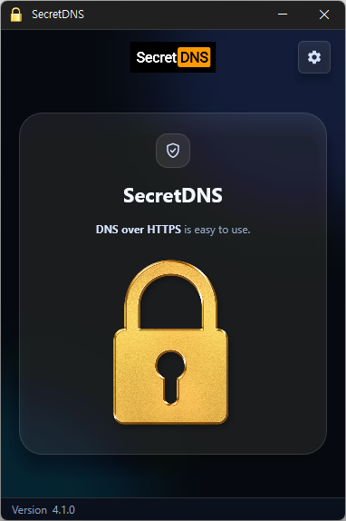

# SecretDNS

**通过 DNS over HTTPS 和 SNI 分片绕过网络监听(DPI)、一键开启的 Windows 免费工具。**

[English](README.md) · [한국어](README.ko.md) · 简体中文 · [日本語](README.ja.md) · [Español](README.es.md) · [Português (Brasil)](README.pt-BR.md) · [Français](README.fr.md)

> 本文档为翻译版本。如有出入,以[韩文版](README.ko.md)为准。

## 概述

打开网站时,电脑会以明文发出两样东西:请求网站 IP 地址的 **DNS 查询**,以及每个 HTTPS 连接第一个数据包中携带的**网站名称(SNI)**。运营商或网络管理员的监听设备(DPI)读取这两项就能知道你在访问哪个网站,并在需要时切断连接或跳转到警告页面。

SecretDNS 只需按一下**锁按钮**就能堵住这两个漏洞。

- **DNS** — 将电脑的 DNS 查询通过 Cloudflare 等服务器以**加密方式(DoH)**处理。完全不改动 Windows 网络设置,所以停止程序后立即恢复原状;即使运行中电脑突然关机,重新开机后也毫无痕迹,上网一切如常。
- **SNI** — 在 HTTPS 连接时**让网站名称不暴露给监听设备**。网站访问本身与平时无异,并且只处理名称部分,几乎没有速度损失。

银行、支付等分片后可能无法使用的网站,通过内置的**例外列表**原样放行;在**报告**中可以查看每个网站是如何处理的。对于在互联网自由得不到保障的国家常见的 **451 错误**(网站方直接拒绝来自该国的连接)这类无法通过 DNS 绕过的网站,可以用**混合代理**只让这些网站经由其他国家访问。指定域名之外的流量不经过代理,因此其余上网速度保持不变。

SecretDNS 不是 VPN。它不隐藏 IP 地址,也不加密全部流量,只处理用于监听的 DNS 和 SNI 两处。

## 主要功能

- **一键开启** — 只需按下主页上的**锁按钮**。点击托盘图标或设置右上角的锁也能开关。
- **DNS over HTTPS** — 默认使用 Cloudflare。可以自行添加服务器并勾选多个,程序会自动切换使用。也有不加密、只使用**指定服务器**(如 1.1.1.1)的模式。
- **不改动 Windows 设置** — 不修改网络适配器的 DNS 设置。停止后不留痕迹,运行中断电或强制关机,重启后也恢复如常。
- **SNI 分片** — 让 HTTPS、HTTP 连接中的网站名称不被暴露。
- **例外列表 / 手动列表** — 指定不分片的网站,或只指定要分片的网站。银行、支付、门户、游戏等约 160 个域名已内置为默认例外。
- **仅限浏览器** — 只对主流浏览器的流量应用分片,不影响游戏和办公软件。默认即为开启。
- **伪装数据包** — 针对仅靠分片不够的线路的额外绕过方式。
- **不断线的连接** — 启动前先确认 DNS 服务器可达;运行中服务器无响应时上网也不会中断,服务器恢复后自动继续。睡眠唤醒、切换 Wi-Fi 后上网也不会停。
- **报告** — 按 DNS、SNI 分别在单独窗口中以表格显示域名和应用结果(加密、分片、明文、经服务器 …),并可复制。
- **混合代理** — 只有列表中的域名经由海外服务器访问。用于打开 DNS 无法绕过的 451 封锁网站;其余流量照常直连,没有速度损失。
- **自动启动 · 托盘** — 开机时自动运行,关闭窗口时最小化到通知区域。
- **22 种语言** — 跟随 Windows 显示语言,也可以在设置的**语言**中直接选择。

## 下载 / 安装

| 类型 | 链接 |
|---|---|
| 安装版 | [下载](https://down.kilho.net/secretdns?lang=zh) |
| 免安装版 (ZIP) | [下载](https://down.kilho.net/secretdns?lang=zh&nosetup) |

安装版在安装完成后立即运行,并同时注册**开机时运行**。免安装版解压 ZIP 后运行 `SecretDNS.exe` 即可。两者都会请求**管理员权限**。

## 使用方法

### 快速上手

1. 运行 SecretDNS。出现管理员权限确认窗口时按 **[是]**。
2. 按下主页中间的**锁按钮**。锁亮起金色即表示正在运行,通知区域(托盘)图标也会变为金色。
3. 像平时一样使用浏览器。无需其他操作。
4. 要关闭时,再按一次锁,或单击托盘图标。关闭窗口(×)不会退出程序,而是收到托盘。

要开启哪些功能,在右上角**齿轮**按钮打开的**设置**中决定。运行中设置会被锁定,需要先停止再修改(**语言**和 **[查看日志]** 在运行中也可使用)。设置右上角的锁可以直接运行或停止,无需返回主页。

### 界面构成

**主页** — 中间是**锁按钮**(运行/停止),右上角是**齿轮**(设置),下方状态栏显示版本。点击顶部的标志会打开官网(其他界面的标志也一样)。

**设置** — 左上角的箭头返回主页,右上角的锁用于运行/停止。停止时锁为打开的灰色,运行时为锁上的金色。

| 项目 | 作用 |
|---|---|
| **DNS设置** — 禁用 / 指定服务器 / DNS over HTTPS | 如何处理 DNS 查询。用指定服务器、DNS over HTTPS 行的 **[服务器设置]** 编辑对应的服务器列表 |
| **SNI设置** — 禁用 / 分片 / 分片ⓜ | 对所有网站分片(例外列表除外),还是只对手动列表中的网站分片 |
| **例外** / **手动** 列表 | 选择分片时,该行下方出现例外列表输入框;选择分片ⓜ时,该行下方出现手动列表输入框。每行写一个 |
| **启用混合代理** | 只有列表中的域名经由海外服务器。勾选后正下方出现列表输入框(需开启 DNS 设置) |
| **仅限浏览器** | 只对浏览器流量应用分片、伪装数据包 |
| **启用伪装数据包** | 针对仅靠分片不够的线路的额外绕过方式 |
| **启用报告** + **[查看日志]** | 保留报告记录。用 **[查看日志]** 打开报告窗口 |
| **开机时运行** | 登录后在托盘自动启动。上次处于运行中时,保护也会自动开启 |
| **语言** | 界面语言。选择**跟随系统**时跟随 Windows 显示语言 |

**DNS 服务器设置** — 以表格显示所按 [服务器设置] 一侧(指定服务器或 DNS over HTTPS)的列表,下方有 **[添加]** · **[编辑]** · **[删除]**。

**报告窗口** — 有**类型**(DNS · SNI · VPN)、**域名**、**应用**三列。相同的行只保留一次,应用栏为空的行(未做任何处理直接发出的)以灰色显示。**[复制]**、**[复制(全部)]** 以制表符分隔的文本复制,**[清空]** 清除列表。窗口大小可调整;主窗口隐藏到托盘后再打开时,报告窗口也会一起恢复。

**托盘图标** — 停止时为灰色,运行时为金色。单击切换运行/停止。右键菜单有 **SecretDNS**(显示窗口)、**运行**、**停止**、**Kilho.net**、**退出**。鼠标悬停显示版本和当前状态。

### 这种情况怎么办

**某个网站跳转到警告页面或连接被切断**
用默认设置(DNS **指定服务器**或 **DNS over HTTPS** + SNI **分片**)按下锁就能解决大多数情况。启用报告后访问该网站,`SNI` 行显示**分片**、`DNS` 行显示**明文**或 **DNS over HTTPS** 即为正常。仍然不行的话,试试下面的**启用伪装数据包**。

**开启 SecretDNS 后某个网站打不开了(银行、支付、游戏登录等)**
这是该网站的通信不适应分片。在设置中**分片**行下方的**例外**列表中添加一行域名,然后重新运行。
- 像 `.example.com` 这样**以点开头**书写,可匹配 `example.com` 及其所有子域名(`www.example.com`、`m.example.com`)。
- 也可以直接粘贴地址栏的 URL — `https://`、`www.` 和后面的路径会自动去掉。
- 在输入框外点击其他位置、离开设置或运行时即保存,**下次运行起**生效。用设置右上角的锁直接运行,无需返回主页。
- 银行、信用卡、支付、门户、购物、游戏、政府(`.go.kr`)、学校(`.ac.kr`)等约 160 个域名已内置为例外,无需再写。即使清空列表,内置例外仍然有效。

**只想对少数网站分片,其他不动**
把 SNI 设置改为**分片ⓜ**,该行下方会出现**手动**列表输入框。只对这里写的域名分片,其余全部原样发送。如果有问题的网站只有一两个,这种方式更稳妥。书写规则与例外列表相同;列表为空时,运行前会提示你填写域名。

**只加密 DNS,不使用分片**
把 DNS 设置设为 **DNS over HTTPS**,SNI 设置设为**禁用**。反之,DNS 不动、只用分片时,把 DNS 设为**禁用**。两者都禁用时会提示"没有可执行的功能。"。

**提示"无法连接到加密 (DoH) DNS 服务器。"**
有些公司、学校的线路能上网,却连不上某些 DoH 服务器。有两种办法。
- 按 DNS over HTTPS 行的 **[服务器设置]**,在列表中勾选其他服务器(例如默认列表中的 **cloudflare-dns.com**)。
- 或者把 DNS 设置改为**指定服务器**。虽然不加密,但不改 Windows 设置就能使用其他 DNS 服务器的效果不变。

**想使用其他 DNS 服务器**
按 DNS 设置中**指定服务器**或 **DNS over HTTPS** 行的 **[服务器设置]**,即可打开对应的服务器列表。
- 用 **[添加]** 输入**名称 · 地址1 · 地址2**(备用,可留空)。指定服务器填 `8.8.8.8` 这样的 IPv4 地址,DoH 填 `https://1.1.1.1/dns-query` 或 `https://dns.google/dns-query` 这样的地址。
- 只使用项目前**勾选**的服务器。勾选多个时,一个无响应会自动切换到其他服务器。一个都不勾选时使用 Cloudflare。
- 默认列表中有 Cloudflare(已勾选)和 Google(未勾选)。
- 修改后的列表**下次运行起**生效。

**不想影响游戏或办公软件**
保持**仅限浏览器**开启(默认即为开启)。分片和伪装数据包只应用于 Chrome、Edge、Firefox、Whale 等主流浏览器的流量,其他程序不受影响。DNS 处理则与程序无关,始终生效。
反之,如果浏览器以外的程序(如下载工具)也需要分片,请关闭**仅限浏览器**。

**分片后仍然被封锁的线路**
试试**启用伪装数据包**。这是针对仅靠分片无法穿过的监听设备的额外绕过方式,不影响实际连接。

**只想让被封锁的网站经由海外服务器访问(混合代理)**
在互联网自由得不到保障的国家,网站方可能直接拒绝来自该国的连接,浏览器显示 **451 错误**(Unavailable For Legal Reasons)。在互联网自由的国家很少见到这种情况。这时 DNS 加密和分片都打不开 — 因为是根据访问来源国家进行封锁的。混合代理只让这些网站经由其他国家的服务器访问。
在开启 DNS 设置的状态下勾选**启用混合代理**,正下方会出现列表输入框。每行写一个域名(`.example.com`,规则与例外列表相同),然后运行即可。
- 只有列表中的域名经由海外服务器,其余照常直连。与整体 VPN 连接不同,其他网站的速度保持不变。
- 每次运行时自动分配服务器,无响应时自动切换到下一个服务器。
- 报告中记录为类型 **VPN**、应用**经服务器**。
- 混合代理需要开启 DNS 设置,把 DNS 设为禁用时会一起关闭。

**想在每次开机时自动开启**
勾选**开机时运行**(安装版在安装时已注册)。登录后不显示窗口、在托盘启动,**如果上次处于运行中状态**,保护也会自动开启。如果是自己停止后退出的,下次开机则不开启而是等待。
开机后 Wi-Fi 连接较慢也没关系,网络连上后会自动启动。

**关闭窗口后也想保持开启**
按关闭(×)不会退出,而是收到托盘,无需另外设置。要完全退出,右键托盘图标 → **退出**(会弹出确认窗口)。退出后保护也一并关闭。

**想更改界面语言**
在设置最下方的**语言**中选择,界面会立即切换为该语言。运行中也可以更改。选择**跟随系统**则重新跟随 Windows 显示语言。

**想查看当前各网站是如何处理的**
开启**启用报告**,用 **[查看日志]** 打开报告窗口。运行中访问的域名会逐行累积。[查看日志] 在运行中也可以按。

| 类型 | 应用 | 含义 |
|---|---|---|
| DNS | **DNS over HTTPS** | 通过加密服务器查询 |
| DNS | **明文** | 通过指定服务器查询(未加密) |
| SNI | **分片** | 网站名称已分片发送 |
| SNI | (空) | 属于例外列表的网站,原样发送 |
| VPN | **经服务器** | 通过混合代理经由海外服务器 |

用 **[复制(全部)]** 复制后粘贴到记事本或 Excel,列会原样分开。

**为什么 DNS 服务器无响应时上网也不会断**
SecretDNS 在运行前会先确认 DNS 服务器可达;运行中服务器暂时无响应时,也会自动处理以保证上网不中断。服务器恢复后自动回到正常运作,期间的状态可在托盘图标和报告中查看。从睡眠唤醒或切换 Wi-Fi 后也无需重新运行。

**出现驱动程序提示窗口**
极少数情况下会提示重新启动计算机后再运行。按提示重启即可。

**运行中电脑关机了**
无需担心。SecretDNS 不改动 Windows 网络设置,只在运行时工作,所以断电或强制关机后重新开机,上网一切如常。开启了开机时运行的话,登录后会自动重新启动。

## 设置

在**设置**中修改,修改后立即保存。大多数设置**下次运行起**生效,升级后设置也会保留。

| 项目 | 默认值(安装版) | 默认值(免安装版) |
|---|---|---|
| DNS设置 | 指定服务器 | 指定服务器 |
| SNI设置 | 分片 | 分片 |
| DNS 服务器列表 | 指定服务器: Cloudflare ✓, Google / DNS over HTTPS: Cloudflare ✓, cloudflare-dns.com ✓, Google | 相同 |
| 启用混合代理 | 关 | 关 |
| 仅限浏览器 | 开 | 开 |
| 启用伪装数据包 | 关 | 关 |
| 启用报告 | 关 | 关 |
| 开机时运行 | 开 | 关 |
| 语言 | 跟随系统 | 跟随系统 |

界面语言跟随 Windows 显示语言(22 种语言,其他为英语),也可以在设置的**语言**中更改。

## 系统要求

- Windows 10 或 Windows 11(32 位和 64 位均可)
- **管理员权限** — 每次启动都会弹出权限确认窗口。
- 无需安装额外的运行库。
- 网络连接 — 用于 DNS 服务器检查和新版本提示。

## 更新

SecretDNS **不会**自动更新。启动时检查是否有新版本并弹出提示窗口,按 **[是]** 会打开下载页面并退出程序。新版本经内部验证后手动发布,并在 [SecretDNS 页面](https://kilho.net/secretdns)公告。请参阅[更新政策说明](https://en.kilho.net/archives/notice/2940)。

## 许可证

SecretDNS 是**免费软件**。公司、家庭、政府机关、学校等任何地方都可无限制免费使用,并可自由再分发。

## 链接

- 官网: <https://kilho.net/secretdns>
- 论坛: <https://kilho.top/forum/qna>
- X (Twitter): <https://www.twitter.com/kilhonet>

© KILHO.NET
